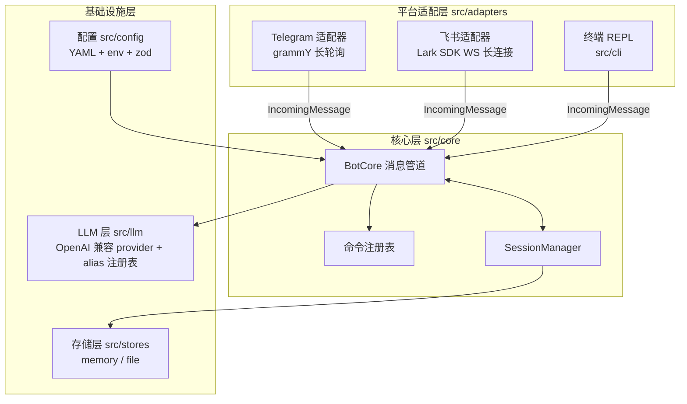
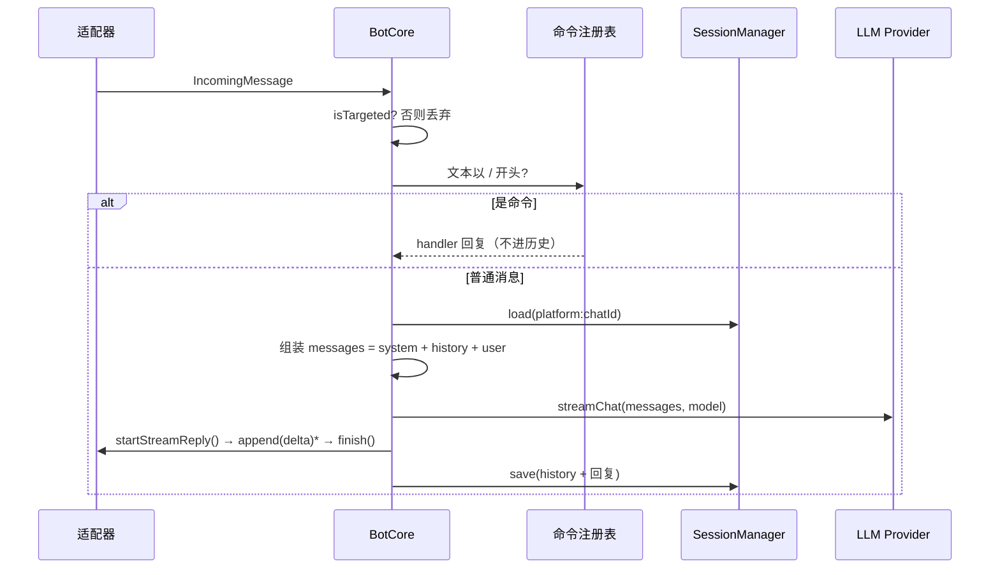

# moss-bots 架构

moss-bots 是接入 Telegram 与飞书的聊天机器人，LLM 层可插拔任意 OpenAI 兼容端点。本文是架构入口文档，随实现演进。

## 分层总览



原则：

- 平台适配器之间**互不 import**，只依赖 `src/adapters/types.ts` 的契约与 `src/core`。
- 核心层不知道任何平台细节：群聊判定、限流、流式节流都封装在适配器内部。
- 所有 id 一律 `string`（Telegram 数字 id 与飞书 `oc_/ou_` 前缀 id 统一字符串化）。

## 核心契约（src/adapters/types.ts）

```ts
interface IncomingMessage {
  platform: 'telegram' | 'feishu';
  chatId: string; // 会话 key 组成部分
  senderId: string;
  senderName: string; // 群聊中拼进历史（"Alice: ..."）
  isGroup: boolean;
  isTargeted: boolean; // 私聊恒 true；群聊 = 被 @ 或被回复 bot 消息（判定在适配器）
  text: string; // 纯文本，已剥离 @botname 前缀
  attachments: { type: 'image' | 'file' | 'audio' | 'other' }[]; // 一期只记录
  raw: unknown; // 原始 payload 逃生舱口
  reply(text): Promise<void>;
  startStreamReply(): Promise<StreamReplyHandle>;
}

interface StreamReplyHandle {
  append(delta: string): Promise<void>; // 适配器内部节流
  finish(): Promise<void>; // 定稿
  abort(err: Error): Promise<void>; // 异常收尾
}
```

`reply` / `startStreamReply` 挂在消息对象而非 adapter 上：回复目标（chat_id、消息 id、卡片上下文）是 per-message 状态。

## 消息处理管道（src/core/bot.ts）



- **会话 key** = `${platform}:${chatId}`，群聊整个群共享一份历史（与 grok bot 群内行为对齐）。
- **system prompt 不进历史**：每次请求动态注入当前 persona，改人设即时生效。
- **模型目录**：`config.models.entries` 定义 alias → (provider, model)，`/model grok` 查目录切换，覆盖值存会话。

## LLM 层（src/llm）

- 唯一实现类 `OpenAICompatProvider`（基于官方 openai SDK，`baseURL` 可配），按配置实例化多份。
- `streamChat(): AsyncIterable<string>` 逐 delta 产出；`chat()` 为聚合便捷方法。
- provider key 校验在启动装配时进行（精确报出该设置哪个环境变量）。

## 存储层（src/stores）

`SessionStore` 接口（load/save/delete）。第一期两种实现：`memory`（默认，`maxHistoryMessages` 封顶裁剪最旧）与 `file`（`data/sessions/` 每 session 一 JSON 文件，best-effort 落盘）。历史只存 user/assistant 轮次，条数封顶不做 token 计数裁剪。

## 配置（src/config）

三层合并：`config.yaml` + `.env` + 内置默认，优先级 env > yaml > default。zod 校验 + 交叉校验（alias→provider、enabled 平台 env 非空）。敏感信息走 `apiKeyEnv` 间接引用——配置文件只存环境变量名。详见 [CONFIG.md](CONFIG.md)。

## 流式回复策略

|      | Telegram                                              | 飞书                                           |
| ---- | ----------------------------------------------------- | ---------------------------------------------- |
| 机制 | 占位消息 → `editMessageText` 渐进更新 → 定稿          | CardKit 流式卡片 → 定稿                        |
| 节流 | ≥1.2s 或 ≥64 字符才编辑；吞 "message is not modified" | 适配器按序提交，约 0.5s 间隔                   |
| 超长 | 单条 4096 上限，超出定稿当前条续发新占位              | 卡片容量大，基本无需分段                       |
| 降级 | 编辑失败 → 直接 reply 全文                            | API 失败或 `streaming: false` → 一次性普通消息 |

第一期回复统一纯文本（不设 parse_mode），规避平台 Markdown 方言差异。

## 生命周期

启动：加载配置 → 装配 LLM 注册表与 store → 构造已启用平台的 adapter → `start()`。停机（SIGINT/SIGTERM）：adapter `stop()` → store flush → 进程退出。进程级 `unhandledRejection`/`uncaughtException` 记日志不崩。
